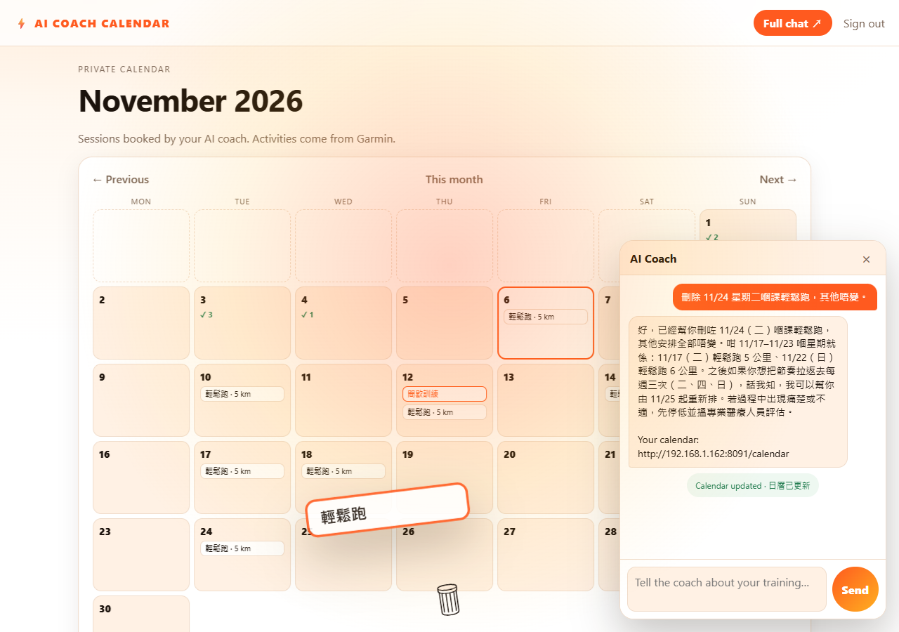

# Design — PoC2

## The promise

"Talk to your coach; it remembers you and turns the conversation into a training calendar."

## Primary flow

```
login (Open WebUI) → chat (one turn at a time) → coach books future sessions
                                            → reply carries the calendar link
                                            → calendar shows each day
                                            → Garmin sync completes past days
                                            → next chat starts from memory + activities
```

## Two chat surfaces, one coach

| Surface | Where | What it is |
|---|---|---|
| Full chat | Open WebUI `:3010` | threads, streaming, mobile, long conversations |
| Chat bubble | inside the calendar `:8091` | quick turns without leaving the calendar; same gateway, same memory, same writes |

The bubble is not an iframe of Open WebUI. It is a small same-origin client of `POST /chat`, which proxies to the coach
gateway (ADR-0003). When a turn books sessions, the bubble calls `GET /calendar/data?month=…` and re-renders the month
cells in place, so the grid updates without a page reload.

## Rules the design keeps

| Rule | Why |
|---|---|
| Chat is the only entry point | the owner's reframing: no wizard, no planner form |
| Memory is written by the coach, not curated by the runner | continuity without admin work |
| The calendar is private and system-owned | it is the coach's artefact, not the user's personal calendar |
| The coach writes future sessions only | the past is a fact; Garmin or a chat report completes it |
| The reply says what was booked and links the calendar | the conversation must lead somewhere visible |
| A rejected model turn changes nothing | a hallucination is visible, never silent |
| No diagnosis, no calories, clinician referral on pain | health humility in the prompt |

## Schedule changes animate

When the coach emits `update` or `remove`, the bubble first captures the old day cells, refreshes the grid, then plays a page-wide
animation: the session chip flies in an arc to its new day (green pulse) or into a bin (red pulse, trash pop), with a full-page
warm flash and a short shake. `add` pops the chip into the target day. The grid is updated before the animation, so the end state
is always correct even if the animation is interrupted.



## Surfaces

- **Calendar** (PoC2 server): month grid, day detail, Garmin sync button, floating coach bubble, link to full chat.
- **Full chat** (Open WebUI): threads, streaming, mobile.
- **No admin mode in PoC2** (non-goal).

## Open design questions

- Whether the calendar should allow manual edits (PoC2 says no).
- Whether memory should expire or be reviewable by the runner (PoC2 keeps it append-only and invisible).
- Whether the bubble should stream tokens (PoC2: no; Open WebUI streams).
- Whether a chat report of a past run should create an activity automatically (PoC2 only maps Garmin today; the coach can
  mention it, the calendar stores Garmin).
